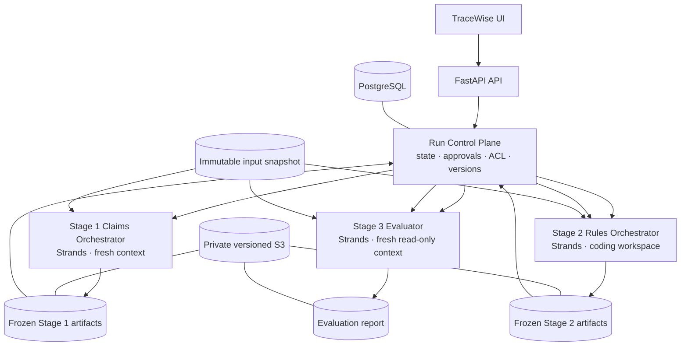

# TraceWise architecture and ownership contract

## Core topology



## Invariants

- Exactly three autonomous orchestrator identities: Claims, Rules and Evaluator.
- The Run Control Plane is deterministic application logic, not a fourth agent.
- No stage starts automatically after the preceding stage finishes. A human reviewer approves the exact current artifact manifest hash/version; the user separately starts the next stage.
- Claims and Rules cannot call each other or inspect each other's session, memory or workspace. Cross-stage handoff uses immutable artifact references and control-plane-routed typed messages.
- Evaluator starts in a fresh context and receives only read-only source/artifact access.
- Original inputs are immutable. A changed source set starts a new source-set/run version.
- Database state is the system of record for claims, run state, approvals, audit events and task status. Strands session memory is not authoritative.
- One Claim record gets one concise Stage 1 Evidence Hint. One Stage 2 EvidenceBundle may contain many sources, tables, rows, joins and lineage coordinates.
- Arithmetic-derived values are not duplicated as independent claims when entity, unit, period, population, denominator and criteria are demonstrably scope-equivalent.
- The reported target number is a reconciliation reference, never an optimization target.
- Generated Python is untrusted. No host process fallback is permitted when an isolated executor is unavailable.

## Stage state graph

```text
READY_FOR_STAGE_1 -> CLAIMS_RUNNING -> CLAIMS_AWAITING_REVIEW
                                      | approve -> CLAIMS_APPROVED
                                      | changes -> CHANGES_REQUESTED
CLAIMS_APPROVED -> RULES_RUNNING -> RULES_AWAITING_REVIEW
                                  | approve -> RULES_APPROVED
                                  | changes -> CHANGES_REQUESTED
RULES_APPROVED -> EVALUATION_RUNNING -> EVALUATION_AWAITING_REVIEW
                                       | final approve -> COMPLETE
                                       | changes -> CHANGES_REQUESTED
```

The current `run_state.py` implements a deterministic transition validator, not durable orchestration. The next pass must persist state transitions transactionally with compare-and-swap versioning.

## Main artifact tree (outside Git)

```text
runs/<tenant_id>/<run_id>/
  input/target/<immutable-original>
  input/sources/<immutable-originals>
  extracted/target_document_blocks.json
  extracted/source_extraction_manifest.json
  stage_1_claims/source_knowledge.md
  stage_1_claims/source_knowledge.json
  stage_1_claims/knowledge_graph.json
  stage_1_claims/schema_profiles.json
  stage_1_claims/relationships.json
  stage_1_claims/claims_register.vNNN.json
  stage_1_claims/claim_history/
  stage_2_rules/claims/<claim_id>/{plan.md,evidence_bundle.json,rule_spec.json,analysis.py,tests/,requirements.lock,execution.json,result.json,provenance.json,tool_history.jsonl,stdout.log,stderr.log,artifact_manifest.json}
  stage_3_evaluation/evaluation_report.json
  stage_3_evaluation/claims/<claim_id>/evaluation.json
  events/
  audit/
```

Each published artifact has a stable logical path, immutable version, SHA-256, media type, size, creation time, producer, stage/claim reference, and dependency edges.

## Service boundaries

| Boundary | Responsibility | Must not do |
|---|---|---|
| FastAPI | Authentication, request validation, authorization, API projection | Run arbitrary model-generated code or own ephemeral state only |
| Run Control Plane | Transitions, approvals, queues, artifact freeze, invalidation, ACL | Interpret pharmacovigilance evidence |
| Strands orchestrators | Autonomous stage decisions and scoped tool use | Bypass stage ACLs or human gates |
| Tool broker | Typed, audited and authorized capabilities | Expose raw SQL, arbitrary absolute paths, shell or credentials |
| Storage | Immutable S3 inputs and artifact versions | Public objects or mutable “latest” source aliases |
| Analytics | Deterministic read-only queries and row lineage | Accept unbounded model SQL or mutate originals |
| Sandbox | Isolated code/test execution | Run generated code in API/worker host process |
| AG-UI event adapter | Translate operational agent/tool/state events into protocol | Stream private chain-of-thought or PHI-rich row dumps |
