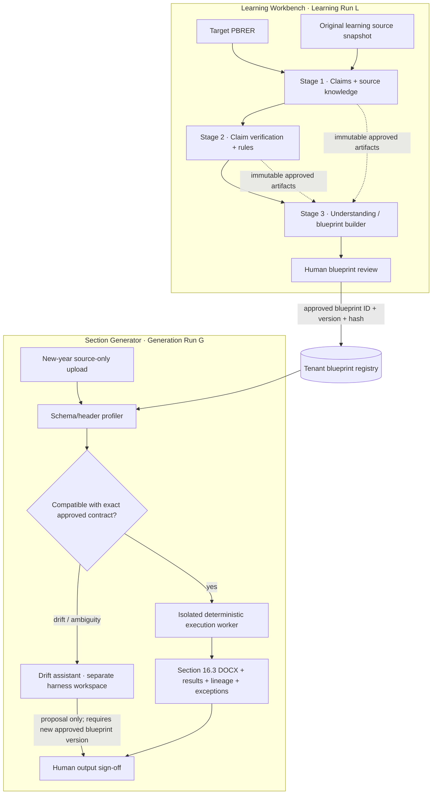

# Separating execution boundaries

## Why this separation exists

TraceWise performs two fundamentally different jobs:

- It learns how a specific PBRER Section 16.3 was assembled.
- It repeatedly applies the approved methodology to future-year data.

Combining authoring and execution in one agent session/workspace creates a dangerous coupling: a model that can edit code might also mutate the methodology while it is calculating; a future-year data drift could silently change a prior approved method; and an annual run could accidentally rely on the previous target PBRER or a learning-run session.

The design therefore uses a **Blueprint Learning boundary** and a **Blueprint Execution boundary**, each with a different run ID, input contract, workspace, permissions, outputs and reviewers.

## Context diagram

## Boundary A — Stage 3 authoring harness

**Inputs:** exact approved Stage 1/2 manifest hashes, target Section 16.3 structure, claims register, sanitized source knowledge, approved Stage 2 rule specs, aggregate results, rule code/tests and provenance.

**Does not receive by default:** the original raw workbooks, row-level evidence snapshots, `claim_data.json`, raw tool stdout/stderr, or agent session memory from other stages. The overlay's `prepare_stage3_readonly_inputs()` copies an allow-listed set of Stage 1/2 artifacts and strips row/sample/record/tool transcript fields. The next coding agent must preserve this least-privilege input builder and extend its allow-list carefully.

**Writes:** an attempt-specific authoring workspace containing the blueprint model, source contracts, claim catalog, retrieval policies, transformation graph, narrative templates, renderer specification, drift policy, deterministic reproduction entry point, tests and validation report.

**Permissions:** read-only access to one sanitized Stage 1/2 artifact snapshot; read/write only to its authoring workspace; no direct writes to upstream run artifacts; no `default_claim_repo.save_claim()`; no access to another agent session; no ability to self-approve.

**Harness reuse:** call `app.harness.runner.run_harness_task()`; do not create another LLM tool loop. The current harness's read/write/edit/list/grep/glob/shell tools remain the authoring tool surface. For production, the runner must be invoked in a dedicated isolated worker with its own workspace and a narrowly scoped IAM role. The current `ShellTool` runs on the host, so the overlay deliberately blocks production Stage 3 until that remote adapter exists. Do not just set an environment variable to bypass the guard.

**Output authority:** it can create `draft` / `needs_review` / `ready_for_review` candidates only. The human reviewer and control plane own approval. Approval records must include exact manifest hash/version.

## Boundary B — schema-drift assistant

This is a child task of the Generation Run, not a persistent modification agent. It runs only when source compatibility is not exact.

**Inputs:** approved blueprint's logical dataset/field contracts, source file/sheet/header profiles, candidate mappings and compatibility findings. It receives schema metadata, not raw source rows.

**Writes:** proposal files in a per-generation drift workspace (`proposed_mappings.json`, `drift_assessment.md`, synthetic tests). It may suggest a field rename, candidate sheet or key hypothesis; it cannot accept it.

**Prohibited:** modifying the approved blueprint files or registry row, running generation calculations, tuning filters to match a previous PBRER, or silently accepting a changed latest-record rule.

**Resolution:** when the proposal changes methodology or reusable source mapping, create a new blueprint version and require a human approval. The old generation remains in `compatibility_review`; after the new blueprint is approved, create a new generation run referencing that new version. This preserves immutable lineage.

## Boundary C — annual deterministic execution

**Inputs:** one exact approved `(blueprint_id, version, manifest_hash)`, one immutable source snapshot for this Generation Run, reporting period start/end, optional as-of date, reviewed source-field mappings, pinned dependencies/runtime image and resource limits.

**Writes:** only its generation workspace and its own generated artifacts.

**Prohibited:** old target report inputs, Stage 1/2 agent sessions, changing blueprint rules, auto-learning new methodology, direct access to AWS credentials, network egress unless explicitly approved, writes to source data, or running arbitrary code on the FastAPI host.

**Execution contract:** the blueprint's `reproduce_section.py` runs via an isolated execution service (ECS/Fargate task or equivalent). Sources are mounted read-only. Workspace is writable. The task has no public IP and no credentials exposed to the script. It returns bounded stdout/stderr and immutable output artifacts. If the executor is unavailable, fail closed.

The existing `app.services.sandbox_client.SandboxClient` currently uses `subprocess.run` against the host interpreter. It is not a true container boundary even if `SANDBOX_BACKEND` is set to a value like `docker`. The overlay's `LocalDevelopmentExecutor` can call that client only behind a development-only explicit opt-in for synthetic data. The `IsolatedWorkerExecutor` is deliberately a fail-closed integration placeholder.

## What a Generation Run may read

- The approved blueprint package (read-only, exact version).
- Its own uploaded source files (read-only).
- Its own generation context (period/as-of/source profiles/mappings).
- Version-pinned runtime dependencies.

It must not read the old Learning Run's source directory or target PBRER. The blueprint is the boundary-crossing artifact. This is how the Generator remains usable when the original learning run is archived, retained elsewhere, or inaccessible.

## Run identity and versioning

- `learning_run_id`: owns the target report, Stage 1/2/3 workflow, approvals and source-learning provenance.
- `blueprint_id + blueprint_version`: a tenant-scoped reusable method. It has its own immutable storage namespace and manifest.
- `generation_id`: owns one future-year source snapshot, compatibility check, execution and output sign-off.

A blueprint is never “updated in place”. A methodology or mapping revision creates `version + 1` with `supersedes`, change rationale, evidence refs and reviewer approval. Generation records preserve which exact version they consumed.

## AG-UI trace boundary

Events are emitted on the ID of the run they belong to. A Learning Run event stream must not silently contain Generation Run tool output or vice versa. Use the existing AG-UI-compatible `EventBroker` but add durable persistence/replay in the production implementation. Emit safe summaries for:

- run/step start/end;
- agent/subagent lifecycle and counts;
- tool start/result/end with redacted arguments and bounded summaries;
- which logical source file/sheet profile was inspected;
- blueprint and generation artifacts as they are written;
- schema compatibility decision and drift severity;
- explicit reviewer gate decisions;
- executor job ID, image digest, exit status, bounded logs and result hashes.

Do not emit model reasoning, patient rows, case identifiers, raw evidence records, secrets or unredacted tool outputs. Every event has a run ID, stage/phase, attempt ID, timestamp and durable sequence ID.
